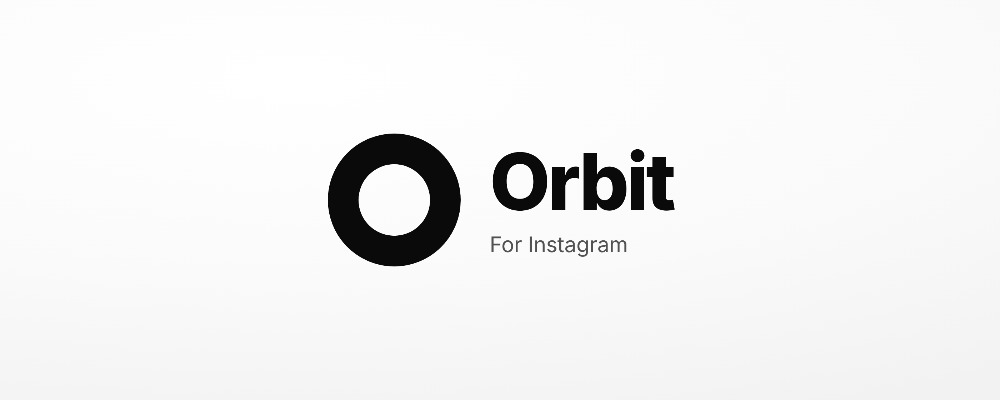
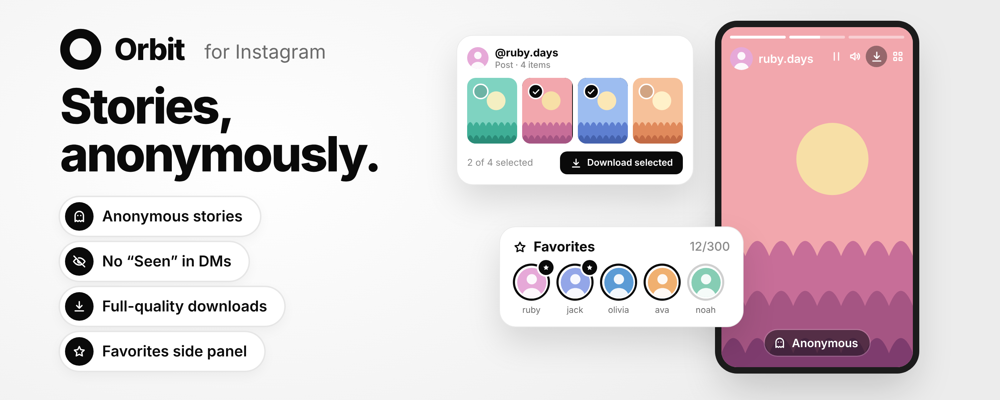
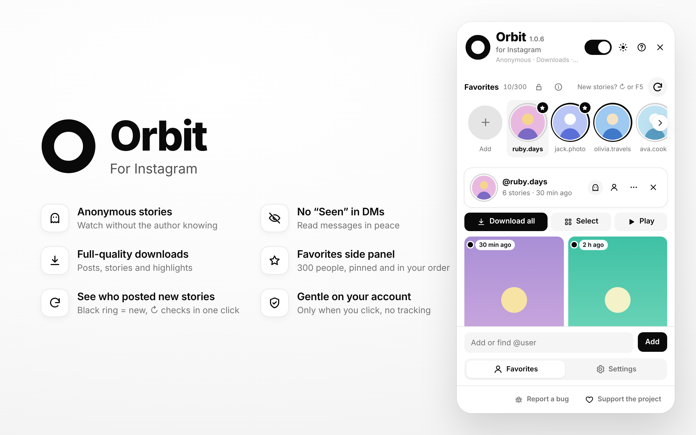
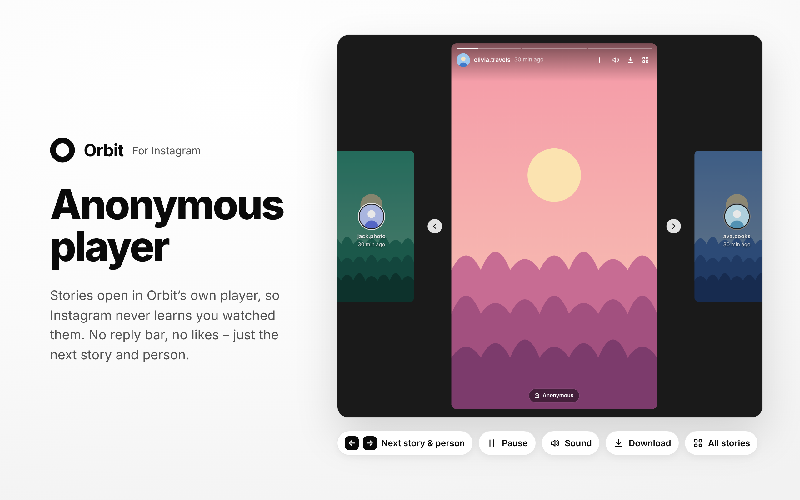
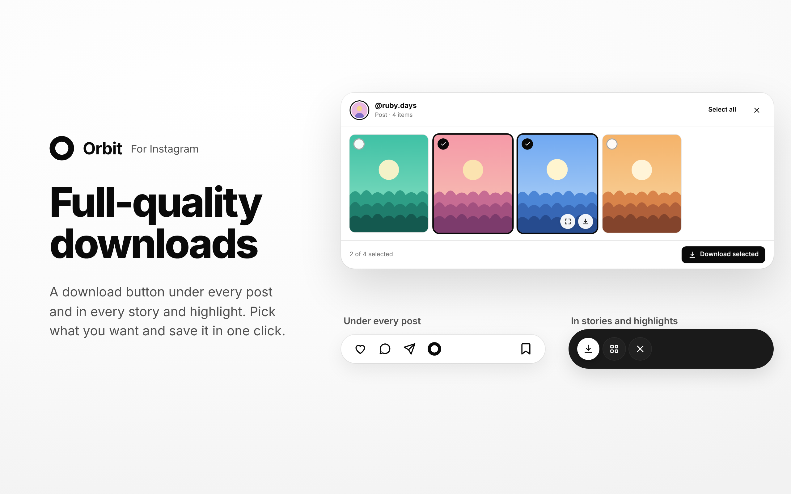
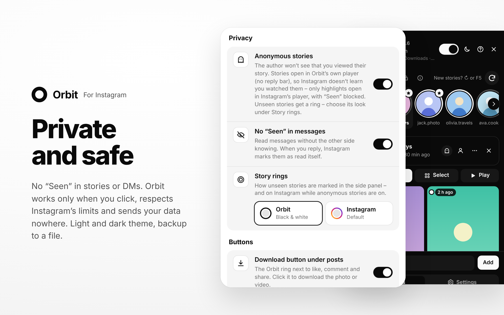
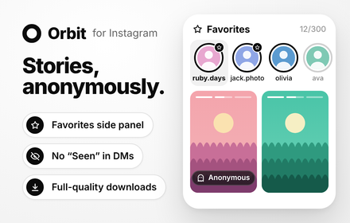

  

  Watch stories anonymously, read DMs without “Seen”, download in full quality 
  and keep favorites in a side panel.

  
  &nbsp;
  

  

  

---

## ◐ Anonymous

- Watch stories without the author knowing
- Stories open in Orbit’s own anonymous player – from the stories row, profile pictures and story links
- Shared posts, mentions and links in a story are clickable – they open in a new tab
- Read DMs without sending “Seen”
- Stories you’ve watched turn gray and move to the end of the stories row – only you see it
- One switch at the top of the panel turns it on or off

## ⤓ Full-quality downloads

- One click under any post, or right in the story player
- Posts with several photos: pick the ones you want or take them all
- All stories or highlights at once – choose and download
- Profile pictures in full size

## ★ Favorites side panel

- Up to 300 people, 5 pinned on top, in your own order (just drag)
- Find or add anyone by @username
- Watch and download their stories right in the panel – always anonymously
- Black ring = new stories, gray = already seen (or Instagram’s colored rings – your choice)
- **↻** checks who has new stories in one click
- Syncs to your other computers through Chrome – and comes back if you reinstall – plus backup to a file

## ◆ Gentle on your account

- No background checks – Orbit only asks Instagram when you open the panel, a story or click **↻**
- At most 15 requests a minute and 100 an hour
- Pauses automatically whenever Instagram asks to slow down

## ☾ Light and dark theme

---

## ▸ How to start

  

1. Install Orbit from the [Chrome Web Store](https://chromewebstore.google.com/detail/orbit-for-instagram/kdamppjnnnkpenecanoghikohljgoaoj)
2. Open [instagram.com](https://www.instagram.com)
3. Click the Orbit icon in your browser toolbar – the side panel opens
4. Anonymous mode is on right away (switch at the top of the panel)
5. Add your favorite people with **+** or the field at the bottom

## ◇ Privacy

Orbit has no servers and sends your data nowhere. No ads, no tracking, no analytics.
Everything stays in your browser – your favorites sync only through your own Chrome account, if Chrome sync is on.

## ✉ Feedback & support

Found a bug, have an idea or a question? Send it through the form – every message gets read.

---

ⓘ Orbit is an independent extension and is not affiliated with, endorsed by or connected to Instagram or Meta Platforms, Inc. Instagram is a trademark of Meta Platforms, Inc. 
This repository contains only the presentation of the extension. The source code is not public.

